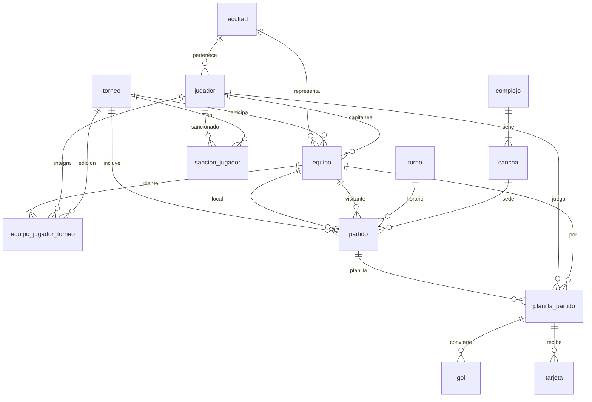

# Modelo de datos

**Referencias**
- **negrita** = clave primaria
- *cursiva* = clave foránea (entre paréntesis, a qué tabla apunta)
- ***negrita y cursiva*** = es clave primaria y foránea a la vez

## Personas

- **login**: **correo**, contrasena, rol
- **facultad**: **id_facultad**, nombre
- **jugador**: **ci**, nombre, apellido, email, fecha_nacimiento, *id_facultad* (facultad), tipo

## Torneo y equipos

- **torneo**: **id_torneo**, nombre, anio, semestre, fecha_inicio, fecha_fin, estado
- **equipo**: **id_equipo**, nombre, *id_torneo* (torneo), *id_facultad* (facultad), *ci_capitan* (jugador)
- **equipo_jugador_torneo**: ***id_equipo*** (equipo), ***ci_jugador*** (jugador), ***id_torneo*** (torneo), numero_camiseta

  > La combinación ci_jugador + id_torneo no se puede repetir, para que un jugador no integre dos equipos en la misma edición.

## Lugares y horarios

- **complejo**: **id_complejo**, nombre, direccion, departamento
- **cancha**: **nombre_cancha**, ***id_complejo*** (complejo), superficie, techada

  > La clave es doble porque distintos complejos pueden tener canchas con el mismo nombre.

- **turno**: **id_turno**, hora_inicio, hora_fin

## Partidos

- **partido**: **id_partido**, *id_torneo* (torneo), numero_fecha, *id_equipo_local* (equipo), *id_equipo_visitante* (equipo), dia, *id_turno* (turno), *nombre_cancha* + *id_complejo* (cancha), estado

  > Cambio respecto a la letra: la clave primaria es solo id_partido (la letra indica id_partido + id_torneo). id_partido ya es único por sí solo, y así planilla_partido, gol y tarjeta pueden referenciar al partido con una sola columna.

- **planilla_partido**: ***id_partido*** (partido), ***ci_jugador*** (jugador), *id_equipo* (equipo)
- **gol**: **id_gol**, *id_partido* + *ci_jugador* (planilla_partido), minuto, autogol
- **tarjeta**: **id_tarjeta**, *id_partido* + *ci_jugador* (planilla_partido), minuto, color

  > En gol y tarjeta, la clave foránea apunta a planilla_partido y no directamente a partido y jugador. Así la base garantiza que solo conviertan goles o reciban tarjetas los jugadores que figuran en la planilla.

## Sanciones

- **sancion_jugador**: **id_sancion**, *ci_jugador* (jugador), *id_torneo* (torneo), motivo, numero_fecha_inicio, cantidad_fechas

## Tipos de dato

AI = AUTO_INCREMENT (la base asigna el número automáticamente)

### login
| Atributo | Tipo |
|---|---|
| correo | VARCHAR(100) |
| contrasena | VARCHAR(255) |
| rol | ENUM('administrador', 'planillero') |

> contrasena es larga porque se guarda hasheada, no en texto plano.

### facultad
| Atributo | Tipo |
|---|---|
| id_facultad | INT AI |
| nombre | VARCHAR(100) |

### jugador
| Atributo | Tipo |
|---|---|
| ci | INT |
| nombre | VARCHAR(50) |
| apellido | VARCHAR(50) |
| email | VARCHAR(100) |
| fecha_nacimiento | DATE |
| id_facultad | INT |
| tipo | ENUM('grado', 'posgrado', 'docente', 'funcionario') |

> ci sin puntos ni guion, con dígito verificador (ej: 12345678).

### torneo
| Atributo | Tipo |
|---|---|
| id_torneo | INT AI |
| nombre | VARCHAR(100) |
| anio | INT |
| semestre | TINYINT |
| fecha_inicio | DATE |
| fecha_fin | DATE |
| estado | ENUM('inscripcion', 'en curso', 'finalizado') |

### equipo
| Atributo | Tipo |
|---|---|
| id_equipo | INT AI |
| nombre | VARCHAR(50) |
| id_torneo | INT |
| id_facultad | INT |
| ci_capitan | INT |

### equipo_jugador_torneo
| Atributo | Tipo |
|---|---|
| id_equipo | INT |
| ci_jugador | INT |
| id_torneo | INT |
| numero_camiseta | TINYINT |

### complejo
| Atributo | Tipo |
|---|---|
| id_complejo | INT AI |
| nombre | VARCHAR(100) |
| direccion | VARCHAR(150) |
| departamento | VARCHAR(30) |

### cancha
| Atributo | Tipo |
|---|---|
| nombre_cancha | VARCHAR(50) |
| id_complejo | INT |
| superficie | ENUM('sintetico', 'parquet') |
| techada | BOOLEAN |

### turno
| Atributo | Tipo |
|---|---|
| id_turno | INT AI |
| hora_inicio | TIME |
| hora_fin | TIME |

### partido
| Atributo | Tipo |
|---|---|
| id_partido | INT AI |
| id_torneo | INT |
| numero_fecha | INT |
| id_equipo_local | INT |
| id_equipo_visitante | INT |
| dia | DATE |
| id_turno | INT |
| nombre_cancha | VARCHAR(50) |
| id_complejo | INT |
| estado | ENUM('programado', 'jugado', 'postergado', 'cancelado') |

### planilla_partido
| Atributo | Tipo |
|---|---|
| id_partido | INT |
| ci_jugador | INT |
| id_equipo | INT |

### gol
| Atributo | Tipo |
|---|---|
| id_gol | INT AI |
| id_partido | INT |
| ci_jugador | INT |
| minuto | TINYINT |
| autogol | BOOLEAN |

### tarjeta
| Atributo | Tipo |
|---|---|
| id_tarjeta | INT AI |
| id_partido | INT |
| ci_jugador | INT |
| minuto | TINYINT |
| color | ENUM('amarilla', 'roja') |

### sancion_jugador
| Atributo | Tipo |
|---|---|
| id_sancion | INT AI |
| ci_jugador | INT |
| id_torneo | INT |
| motivo | ENUM('roja', 'acumulacion de amarillas', 'disciplinaria') |
| numero_fecha_inicio | INT |
| cantidad_fechas | TINYINT |

## Diagrama de relaciones

