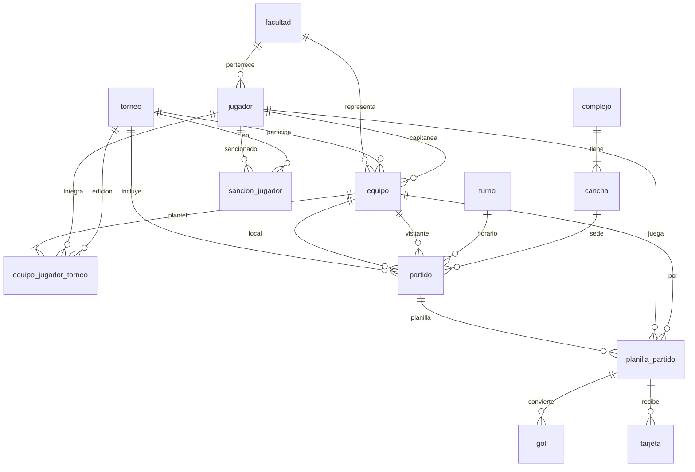

# Modelo de datos

**Referencias**
- **negrita** = clave primaria
- *cursiva* = clave foránea (entre paréntesis, a qué tabla apunta)
- ***negrita y cursiva*** = es clave primaria y foránea a la vez

## Personas

- **login**: **correo**, contrasena, rol
- **facultad**: **id_facultad**, nombre
- **jugador**: **ci**, nombre, apellido, email, fecha_nacimiento, *id_facultad* (facultad), tipo

## Torneo y equipos

- **torneo**: **id_torneo**, nombre, anio, semestre, fecha_inicio, fecha_fin, estado
- **equipo**: **id_equipo**, nombre, *id_torneo* (torneo), *id_facultad* (facultad), *ci_capitan* (jugador)
- **equipo_jugador_torneo**: ***id_equipo*** (equipo), ***ci_jugador*** (jugador), ***id_torneo*** (torneo), numero_camiseta

  > La combinación ci_jugador + id_torneo no se puede repetir, para que un jugador no integre dos equipos en la misma edición.

## Lugares y horarios

- **complejo**: **id_complejo**, nombre, direccion, departamento
- **cancha**: **nombre_cancha**, ***id_complejo*** (complejo), superficie, techada

  > La clave es doble porque distintos complejos pueden tener canchas con el mismo nombre.

- **turno**: **id_turno**, hora_inicio, hora_fin

## Partidos

- **partido**: **id_partido**, *id_torneo* (torneo), numero_fecha, *id_equipo_local* (equipo), *id_equipo_visitante* (equipo), dia, *id_turno* (turno), *nombre_cancha* + *id_complejo* (cancha), estado

  > Cambio respecto a la letra: la clave primaria es solo id_partido (la letra indica id_partido + id_torneo). id_partido ya es único por sí solo, y así planilla_partido, gol y tarjeta pueden referenciar al partido con una sola columna.

- **planilla_partido**: ***id_partido*** (partido), ***ci_jugador*** (jugador), *id_equipo* (equipo)
- **gol**: **id_gol**, *id_partido* + *ci_jugador* (planilla_partido), minuto, autogol
- **tarjeta**: **id_tarjeta**, *id_partido* + *ci_jugador* (planilla_partido), minuto, color

  > En gol y tarjeta, la clave foránea apunta a planilla_partido y no directamente a partido y jugador. Así la base garantiza que solo conviertan goles o reciban tarjetas los jugadores que figuran en la planilla.

## Sanciones

- **sancion_jugador**: **id_sancion**, *ci_jugador* (jugador), *id_torneo* (torneo), motivo, numero_fecha_inicio, cantidad_fechas

## Diagrama de relaciones

